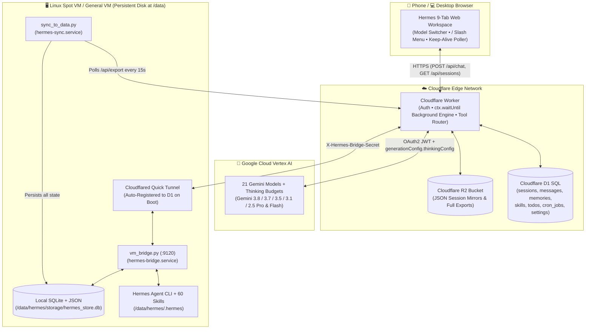
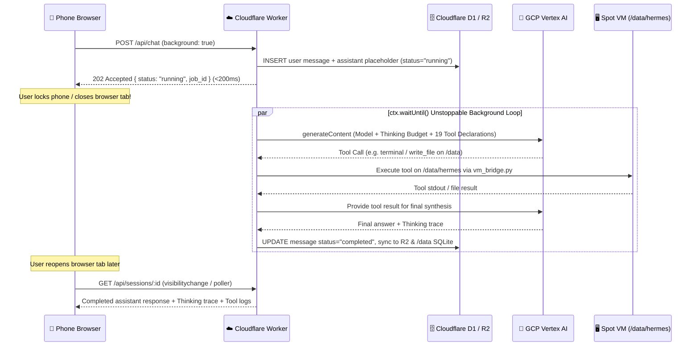

# Hermes Agent ☤ — Autonomous Web Workspace on Cloudflare Edge, Google Vertex AI & Spot VM (`/data`)

> **Full-Stack Autonomous AI Workspace** combining [NousResearch/hermes-agent](https://github.com/NousResearch/hermes-agent) with **21 Google Cloud Vertex AI Gemini Models**, **Configurable Thinking Budgets (`1K`–`24K` tokens)**, **19 Native Agentic Tools**, **60 Procedural Skills**, **Unstoppable Background Execution** (continues running even when you close your phone browser or lock your screen), and **Spot VM Preemption-Resilient `/data` Persistent Storage** backed by **Cloudflare Workers + D1 + R2**.

---

## 📖 Table of Contents

1. [Executive Summary](#-1-executive-summary)
2. [What Was Done & How It Was Built (End-to-End Progress Report)](#-2-what-was-done--how-it-was-built-end-to-end-progress-report)
3. [System Architecture & Data Flows](#-3-system-architecture--data-flows)
4. [Complete Feature Matrix](#-4-complete-feature-matrix)
5. [Repository Structure](#-5-repository-structure)
6. [End-to-End Deployment Guide (Spot VM / General VM + Cloudflare + Vertex AI)](#-6-end-to-end-deployment-guide-spot-vm--general-vm--cloudflare--vertex-ai)
   - [Step 1: Google Cloud Vertex AI Setup](#step-1-google-cloud-vertex-ai-setup)
   - [Step 2: Spot VM / General VM & Persistent Disk (`/data`) Setup](#step-2-spot-vm--general-vm--persistent-disk-data-setup)
   - [Step 3: Install Hermes Agent Core on `/data/hermes`](#step-3-install-hermes-agent-core-on-datahermes)
   - [Step 4: Deploy Cloudflare Worker, D1 Database & R2 Bucket](#step-4-deploy-cloudflare-worker-d1-database--r2-bucket)
   - [Step 5: Configure & Enable Spot VM Auto-Healing Systemd Services](#step-5-configure--enable-spot-vm-auto-healing-systemd-services)
7. [Automated End-to-End Verification (`tester-army/e2e` + Playwright)](#-7-automated-end-to-end-verification-tester-armye2e--playwright)
8. [Detailed Documentation Links](#-8-detailed-documentation-links)

---

## 🚀 1. Executive Summary

Running an autonomous coding and research agent like **Hermes Agent** in production presents four classic infrastructure challenges:
1. **Model Diversity & Deep Reasoning**: You want instant switching across the entire **Google Cloud Vertex AI Gemini catalog** (from ultra-fast `gemini-2.5-flash-lite` to deep-reasoning `gemini-3.8-flash-thinking`, `gemini-3.1-pro-thinking`, and `gemini-2.5-pro-thinking`) with explicit control over **Thinking Budgets (`Auto`, `Off`, `1K`, `4K`, `16K`, `24K`)**.
2. **Mobile & Off-Screen Resilience**: When you dispatch a long multi-step coding or research task from your phone browser and immediately lock your screen or close the tab, traditional SSE/streaming web apps abort the in-flight request.
3. **Spot VM Preemption & Reboot Survival**: Spot VMs offer 60–90% cost savings over standard cloud instances, but can be preempted, rebooted, or reallocated at any time. Any state stored on the ephemeral OS disk (`/root`) or hardcoded to a temporary tunnel URL is lost unless engineered around a persistent disk (`/data`) and self-registering tunnels.
4. **Full Tool & Skill Parity on the Web**: The web UI must expose every capability of the Hermes Agent CLI—bash execution, Python/Node sandboxes, `/data` filesystem editing, procedural skill creation (`/learn`), Mixture-of-Agents (`/moa`), persistent memory (`MEMORY.md`, `SOUL.md`, `USER.md`), Kanban boards, and cron scheduling—behind owner-only authentication.

This repository provides the complete, production-hardened implementation solving all four challenges.

---

## 🛠️ 2. What Was Done & How It Was Built (End-to-End Progress Report)

Below is the chronological, end-to-end breakdown of what was designed, implemented, debugged, and verified:

### Phase 1: Hermes Agent Core & 60 Procedural Skills on `/data/hermes`
- **What was done**: Installed the full [NousResearch/hermes-agent](https://github.com/NousResearch/hermes-agent) runtime and virtual environment directly onto the persistent disk at `/data/hermes/.hermes/` alongside **60 procedural skills** (`SKILL.md` bundles covering GitHub workflows, Docker/Kubernetes, PDF/DOCX/XLSX processing, ArXiv research, MCP integration, Jira/Linear, security auditing, and autonomous `/learn` skill extraction).
- **How it works**: Symlinks (`/root/.hermes -> /data/hermes/.hermes` and `/usr/local/bin/hermes -> /data/hermes/.hermes/hermes-agent/venv/bin/hermes`) ensure both the CLI and web bridge always read and write to `/data/hermes`.

### Phase 2: Google Cloud Vertex AI Integration (21 Gemini Models + Thinking Budgets)
- **What was done**: Built a zero-dependency WebCrypto RS256 OAuth2 JWT token minter inside the Cloudflare Worker (`cloudflare-worker/src/index.js`) that authenticates directly against `https://oauth2.googleapis.com/token` using a GCP Service Account (`GCP_SA_KEY`) and calls Vertex AI regional/global endpoints (`aiplatform.googleapis.com`).
- **How it works**:
  - Supports **21 Gemini model variants** out of the box (including `gemini-3.8-flash`, `gemini-3.8-flash-thinking`, `gemini-4-argon`, `gemini-4-argon-thinking`, `gemini-3.7-flash`, `gemini-3.5-flash`, `gemini-3.1-pro-preview`, `gemini-3.1-pro-thinking`, `gemini-2.5-pro`, `gemini-2.5-pro-thinking`, `gemini-2.5-flash`, `gemini-2.5-flash-thinking`, and `gemini-2.5-flash-lite`).
  - Maps the UI's **Thinking Budget selector** (`auto`, `none`, `low` = `1024`, `medium` = `4096`, `high` = `16384`, `max` = `24576`) directly into Vertex AI's `generationConfig.thinkingConfig.thinkingBudget` payload, returning both `thought` traces and final responses to the UI.

### Phase 3: Cloudflare Edge Workspace (`Workers` + `D1` SQLite + `R2` Storage)
- **What was done**: Deployed a globally accessible Cloudflare Worker (`cloudflare-worker/`) bound to a **Cloudflare D1 SQL database** (`schema.sql`) and a **Cloudflare R2 bucket** (`STORAGE`), protected by owner authentication (`AUTH_USERNAME` / `AUTH_PASSWORD`).
- **How it works**:
  - Every session, message, thinking trace, tool call log, memory file (`MEMORY.md`, `SOUL.md`, `USER.md`), custom skill, Kanban task, and cron schedule is stored in **Cloudflare D1** and mirrored as JSON snapshots into **Cloudflare R2** (`sessions/<id>.json`, `state/full_export.json`).

### Phase 4: Spot VM `/data` Persistence & Automatic Preemption Recovery
- **What was done**: Engineered three cooperating services on `/data/hermes` (`spot-vm-bridge/`) so the Spot VM can be rebooted or reallocated at any moment without losing a single byte of data or breaking the web connection:
  1. **`vm_bridge.py` (`hermes-bridge.service`)**: Runs an authenticated HTTP bridge on port `9120` alongside a `cloudflared` tunnel. Whenever the Spot VM boots or restarts, `vm_bridge.py` parses the newly assigned `https://*.trycloudflare.com` URL and automatically `POST`s it to `/api/bridge/register` on the Cloudflare Worker (authenticated via `X-Hermes-Bridge-Secret`). The Worker updates its D1 `settings` table immediately.
  2. **`sync_to_data.py` (`hermes-sync.service`)**: Polls `/api/export` every 15 seconds and writes all sessions, messages, memories, skills, todos, and cron jobs into a local SQLite database at **`/data/hermes/storage/hermes_store.db`** as well as individual `/data/hermes/storage/sessions/*.json` files.
  3. **`boot.sh` (`@reboot` cron + bootstrap script)**: Restores all OS-level symlinks, binaries (`/usr/local/bin/hermes`, `/usr/local/bin/cloudflared`), and `/etc/systemd/system/hermes-*.service` units directly from `/data/hermes` if the Spot VM OS image is ever replaced.

### Phase 5: 19 Native Hermes Agent Tools, 10 Slash Commands & 9 Workspace Tabs
- **What was done**: Implemented all **19 Hermes Agent tools** (`terminal`, `execute_code`, `read_file`, `write_file`, `patch`, `search_files`, `web_search`, `web_extract`, `mixture_of_agents`, `memory`, `skills_list`, `skill_view`, `skill_create`, `todo`, `session_search`, `cronjob`, `delegate_task`, `clarify`, `text_to_speech`) and **10 interactive `/` slash commands** (`/help`, `/doctor`, `/status`, `/moa`, `/learn`, `/goal`, `/compress`, `/memory`, `/skills`, `/clear`).
- **How it works**: Redesigned `cloudflare-worker/src/ui.js` into a responsive, mobile-first and desktop-ready 9-tab workspace:
  1. 💬 **Chat & Sessions** (Model/Thinking/Toolset selectors, `/` Slash Command popup menu, collapsible Thinking & Tool trace boxes, Web Speech TTS)
  2. ⚡ **Background Jobs** (Live queue of running and completed background jobs with one-click session jump)
  3. 💻 **Terminal & Code** (Direct bash command runner on `/data/hermes` + Python/Node sandbox)
  4. 📚 **Skills Hub (60)** (Search, inspect, and create procedural `SKILL.md` skills on `/data/hermes/.hermes/skills`)
  5. 🧠 **Memory & SOUL** (Live editor for `MEMORY.md`, `SOUL.md`, and `USER.md` synced to `/data/hermes/.hermes/memories`)
  6. 📋 **Kanban & Todos** (3-column Todo / In-Progress / Done board shared between user and agent `todo` tool)
  7. ⏰ **Cron Scheduler** (Recurring scheduled prompts stored in D1 + `/data`)
  8. 📁 **`/data` Files Explorer** (Browse and inspect files across `/data/hermes` and `/data/hermes/storage`)
  9. 🩺 **Doctor & Stats** (Live `hermes doctor` / `hermes status` CLI diagnostics, Spot VM systemd health, and `/data` disk usage)

### Phase 6: Unstoppable Background Execution (Phone Off-Screen / Tab-Close Resilience)
- **What was done**: Decoupled agent turn execution from the browser's HTTP connection lifetime.
- **How it works**:
  - When you tap **Send** with `🔄 Keep-Alive: ON` (enabled by default), `POST /api/chat` immediately inserts the user prompt and a placeholder assistant message (`status: 'running'`) into Cloudflare D1, schedules the full multi-step Vertex AI + Spot VM tool loop inside **Cloudflare Worker's `ctx.waitUntil(...)`**, and returns `{ status: 'running', job_id, message_id }` in `<200ms`.
  - Even if you close your mobile browser tab, switch apps, or lock your phone screen 100ms after tapping Send, Cloudflare Edge + the Spot VM bridge finish the entire agentic loop and persist the final output to D1, R2, and `/data/hermes/storage/hermes_store.db`.
  - While the tab is open—or as soon as you reopen it—`startBackgroundPoller()` (`visibilitychange` + 2.2s interval poller) seamlessly streams updates and renders the completed answer.

### Phase 7: End-to-End Automated Verification (`tester-army/e2e` + Playwright)
- **What was done**: Cloned and integrated [`tester-army/e2e`](https://github.com/tester-army/e2e) (`e2e v0.21.2` + `@e2e-dev/web` + `@ai-sdk/google-vertex`) inside `e2e/` to test the real deployed frontend across both **`desktop` (`1440×900`)** and **`phone` (`390×844`)** targets.
- **How it works**: Combines deterministic Playwright/screen assertions with AI-driven `agent.act(...)` and `agent.assert(...)` powered by Vertex AI `gemini-2.5-flash`. All **10/10 test/target pairs pass (`Exit code 0`)** with full step-by-step `.e2e/results/*/trace.md` reports.

---

## 🏗️ 3. System Architecture & Data Flows

### High-Level Topology



### Unstoppable Background Execution Lifecycle (`Keep-Alive: ON`)



---

## ✨ 4. Complete Feature Matrix

| Category | Capability | Implementation Details |
| :--- | :--- | :--- |
| **Models** | **21 Google Vertex AI Models** | `gemini-3.8-flash`, `gemini-3.8-flash-thinking`, `gemini-4-argon`, `gemini-4-argon-thinking`, `gemini-3.7-flash`, `gemini-3.7-flash-thinking`, `gemini-3.6-flash`, `gemini-3.5-flash`, `gemini-3.5-flash-thinking`, `gemini-3.5-flash-lite`, `gemini-3.1-pro-preview`, `gemini-3.1-pro-thinking`, `gemini-3.1-pro-customtools`, `gemini-3.1-flash-lite`, `gemini-3.0-flash`, `gemini-3.0-flash-thinking`, `gemini-2.5-pro`, `gemini-2.5-pro-thinking`, `gemini-2.5-flash`, `gemini-2.5-flash-thinking`, `gemini-2.5-flash-lite` |
| **Reasoning** | **Thinking Budget Control** | `Auto`, `Off (0)`, `Low (1,024)`, `Medium (4,096)`, `High (16,384)`, `Max (24,576)` tokens |
| **Toolsets** | **19 Native Hermes Tools** | `terminal`, `execute_code`, `read_file`, `write_file`, `patch`, `search_files`, `web_search`, `web_extract`, `mixture_of_agents`, `memory`, `skills_list`, `skill_view`, `skill_create`, `todo`, `session_search`, `cronjob`, `delegate_task`, `clarify`, `text_to_speech` |
| **Slash Menu** | **10 Interactive `/` Commands** | `/help`, `/doctor`, `/status`, `/moa`, `/learn`, `/goal`, `/compress`, `/memory`, `/skills`, `/clear` |
| **Skills Hub** | **60 Procedural Skills** | Stored in `/data/hermes/.hermes/skills/` + D1; extensible via `/learn` or the Skills Hub UI |
| **Persistence** | **Triple-Redundant Storage** | 1) `/data/hermes/storage/hermes_store.db` (Spot VM SQLite), 2) Cloudflare D1 SQL, 3) Cloudflare R2 Object Storage |
| **Resilience** | **Spot VM Reboot Survival** | `boot.sh` + `hermes-bridge.service` + `hermes-sync.service` + `hermes-dashboard.service` |
| **Testing** | **`tester-army/e2e` Suite** | 10/10 passing across `desktop` (`1440x900`) and `phone` (`390x844`) with deterministic + AI `agent.act`/`agent.assert` steps |

---

## 📂 5. Repository Structure

```text
.
├── README.md                        # End-to-End Overview, Progress Report & Quickstart Guide
├── .env.example                     # Environment variable template for Spot VM & E2E suite
├── cloudflare-worker/               # Cloudflare Edge Worker + D1 + R2 application
│   ├── wrangler.toml                # Wrangler configuration template
│   ├── schema.sql                   # Cloudflare D1 SQLite schema (7 tables + indexes)
│   └── src/
│       ├── index.js                 # Worker API router, Auth, Vertex AI OAuth2 + Thinking, ctx.waitUntil(), /moa, /learn
│       ├── tools.js                 # 19 Hermes Tool declarations, executors, 60 skills catalog & slash commands
│       └── ui.js                    # Responsive 9-Tab Web Workspace UI (Desktop + Mobile)
├── spot-vm-bridge/                  # Spot VM / General VM persistent disk services (/data/hermes)
│   ├── vm_bridge.py                 # HTTP Execution Bridge (:9120) + Cloudflare Quick Tunnel auto-registration
│   ├── sync_to_data.py              # Continuous D1/R2 -> /data/hermes/storage/hermes_store.db SQLite sync daemon
│   ├── boot.sh                      # Spot VM preemption/reallocation recovery bootstrap script
│   └── systemd/
│       ├── hermes-bridge.service    # Systemd unit for Spot VM Bridge + Cloudflare Tunnel
│       ├── hermes-sync.service      # Systemd unit for continuous /data SQLite sync
│       └── hermes-dashboard.service # Systemd unit for local Hermes CLI dashboard
├── e2e/                             # Automated End-to-End test suite (tester-army/e2e + Playwright)
│   ├── package.json                 # E2E dependencies (e2e, @e2e-dev/web, @ai-sdk/google-vertex)
│   ├── e2e.config.ts                # Dual-target (desktop + phone) + Vertex AI QA agent config
│   └── tests/
│       ├── auth.setup.e2e.ts        # Authentication session setup
│       └── workspace.e2e.ts         # 4 E2E tests covering models, / menu, 9 tabs, background jobs & AI assertions
└── docs/                            # Deep-Dive Technical Documentation
    ├── ARCHITECTURE.md              # Internal architecture, API reference, database schema & security design
    ├── DEPLOYMENT_GUIDE.md          # Complete step-by-step runbook for Spot VM + Cloudflare + Vertex AI
    └── E2E_TESTING.md               # Guide to running and extending the tester-army/e2e test suite
```

---

## 🛠️ 6. End-to-End Deployment Guide (Spot VM / General VM + Cloudflare + Vertex AI)

> For a command-by-command copy-paste runbook with troubleshooting tips, see [**`docs/DEPLOYMENT_GUIDE.md`**](docs/DEPLOYMENT_GUIDE.md).

### Prerequisites
- A **Linux Spot VM or General VM** (Ubuntu/Debian recommended) with a **persistent disk mounted at `/data`**
- A **Google Cloud Platform (GCP) project** with the **Vertex AI API** (`aiplatform.googleapis.com`) enabled
- A **Cloudflare account** (Free or Paid) with `wrangler` authenticated (`npx wrangler login`)
- `python3`, `nodejs` (v20+), `git`, and `sqlite3` installed on the VM

---

### Step 1: Google Cloud Vertex AI Setup

1. Enable the Vertex AI API in your GCP project:
   ```bash
   gcloud services enable aiplatform.googleapis.com --project="YOUR_GCP_PROJECT_ID"
   ```
2. Create a Service Account and grant it `roles/aiplatform.user`:
   ```bash
   gcloud iam service-accounts create hermes-vertex-sa \
     --display-name="Hermes Agent Vertex AI Service Account" \
     --project="YOUR_GCP_PROJECT_ID"

   gcloud projects add-iam-policy-binding "YOUR_GCP_PROJECT_ID" \
     --member="serviceAccount:hermes-vertex-sa@YOUR_GCP_PROJECT_ID.iam.gserviceaccount.com" \
     --role="roles/aiplatform.user"
   ```
3. Export a JSON key file (you will upload this as an encrypted Cloudflare Worker secret in Step 4, then delete the local file):
   ```bash
   gcloud iam service-accounts keys create /tmp/gcp-sa-key.json \
     --iam-account="hermes-vertex-sa@YOUR_GCP_PROJECT_ID.iam.gserviceaccount.com"
   ```

---

### Step 2: Spot VM / General VM & Persistent Disk (`/data`) Setup

1. Ensure your persistent disk is mounted at `/data` and added to `/etc/fstab` by `UUID` with `nofail` so the VM always boots cleanly even across Spot reallocations:
   ```bash
   # Find the UUID of your persistent disk (e.g. /dev/sda or /dev/sdb)
   blkid
   # Add to /etc/fstab:
   # UUID=<YOUR-DISK-UUID> /data ext4 defaults,nofail,x-systemd.device-timeout=10 0 2
   sudo mkdir -p /data/hermes /data/bin
   ```
2. Install `cloudflared` onto `/data/bin/cloudflared`:
   ```bash
   curl -L https://github.com/cloudflare/cloudflared/releases/latest/download/cloudflared-linux-amd64 \
     -o /data/bin/cloudflared
   chmod +x /data/bin/cloudflared
   sudo ln -sfn /data/bin/cloudflared /usr/local/bin/cloudflared
   ```

---

### Step 3: Install Hermes Agent Core on `/data/hermes`

1. Clone this repository and install [NousResearch/hermes-agent](https://github.com/NousResearch/hermes-agent) onto `/data/hermes`:
   ```bash
   git clone https://github.com/ajithvnr2001/hermes-agent-vertex-cloudflare.git /data/hermes/repo
   export HERMES_HOME="/data/hermes/.hermes"
   mkdir -p "$HERMES_HOME"
   ln -sfn /data/hermes/.hermes /root/.hermes

   # Install Hermes Agent into /data/hermes/.hermes
   curl -fsSL https://raw.githubusercontent.com/NousResearch/hermes-agent/main/scripts/install.sh | bash
   ```
2. Copy the Spot VM bridge scripts into `/data/hermes/`:
   ```bash
   cp /data/hermes/repo/spot-vm-bridge/vm_bridge.py /data/hermes/vm_bridge.py
   cp /data/hermes/repo/spot-vm-bridge/sync_to_data.py /data/hermes/sync_to_data.py
   cp /data/hermes/repo/spot-vm-bridge/boot.sh /data/hermes/boot.sh
   cp /data/hermes/repo/spot-vm-bridge/systemd/*.service /data/hermes/
   chmod +x /data/hermes/vm_bridge.py /data/hermes/sync_to_data.py /data/hermes/boot.sh
   ```

---

### Step 4: Deploy Cloudflare Worker, D1 Database & R2 Bucket

1. Copy the worker directory to `/data/hermes/hermes-cloudflare-web`:
   ```bash
   cp -r /data/hermes/repo/cloudflare-worker /data/hermes/hermes-cloudflare-web
   cd /data/hermes/hermes-cloudflare-web
   ```
2. Create the Cloudflare D1 database and R2 bucket:
   ```bash
   npx wrangler d1 create hermes-memory-db
   npx wrangler r2 bucket create hermes-persistent-storage
   ```
3. Update `wrangler.toml` with:
   - Your `database_id` from the `d1 create` output
   - `VERTEX_PROJECT_ID = "your-gcp-project-id"`
   - `AUTH_USERNAME = "your-email@example.com"`
   - Your custom domain under `routes` (or comment out `routes` to use your `*.workers.dev` URL)
4. Initialize the D1 database schema:
   ```bash
   npx wrangler d1 execute hermes-memory-db --remote --file=schema.sql
   ```
5. Upload your encrypted secrets to Cloudflare Worker:
   ```bash
   npx wrangler secret put GCP_SA_KEY < /tmp/gcp-sa-key.json
   rm -f /tmp/gcp-sa-key.json
   npx wrangler secret put AUTH_PASSWORD
   npx wrangler secret put BRIDGE_SECRET
   ```
6. Deploy the Cloudflare Worker:
   ```bash
   npx wrangler deploy
   ```

---

### Step 5: Configure & Enable Spot VM Auto-Healing Systemd Services

1. Set your environment variables in `/data/hermes/hermes-bridge.service` and `/data/hermes/hermes-sync.service` (or via `/data/hermes/.env`):
   - `HERMES_WORKER_URL="https://your-hermes-domain.example.com"`
   - `HERMES_AUTH_USER="your-email@example.com"`
   - `HERMES_AUTH_PASSWORD="your-strong-password"`
   - `HERMES_BRIDGE_SECRET="your-bridge-secret"`
2. Run `/data/hermes/boot.sh` to install and start all systemd services and register the `@reboot` recovery hook:
   ```bash
   sudo /data/hermes/boot.sh
   (crontab -l 2>/dev/null | grep -v '/data/hermes/boot.sh'; echo '@reboot /data/hermes/boot.sh >> /data/hermes/logs/boot.log 2>&1') | crontab -
   ```
3. Verify all 3 systemd services are `enabled` and `active`:
   ```bash
   systemctl status hermes-bridge.service hermes-sync.service hermes-dashboard.service
   ```

---

## 🧪 7. Automated End-to-End Verification (`tester-army/e2e` + Playwright)

This repository includes a complete [`tester-army/e2e`](https://github.com/tester-army/e2e) test suite in [`e2e/`](e2e/) that verifies both **`desktop` (`1440×900`)** and **`phone` (`390×844`)** viewports end-to-end:

```bash
cd e2e
npm install
npx playwright install chromium

export HERMES_WORKER_URL="https://your-hermes-domain.example.com"
export HERMES_AUTH_USER="your-email@example.com"
export HERMES_AUTH_PASSWORD="your-strong-password"
export GCP_PROJECT_ID="your-gcp-project-id"

npx e2e run --reporter list,markdown
```

### Latest Verified E2E Run Summary (`10/10 Passed`)

| Status | Target | Test Suite | Agent Steps | Duration |
| :--- | :--- | :--- | :--- | :--- |
| 🟢 **PASS** | `desktop` | `tests/auth.setup.e2e.ts` › `authenticate as admin` | — | `1.4s` |
| 🟢 **PASS** | `phone` | `tests/auth.setup.e2e.ts` › `authenticate as admin` | — | `1.8s` |
| 🟢 **PASS** | `desktop` | `model selector (21 Vertex AI models), thinking budget, toolsets, and / slash menu` | — | `2.8s` |
| 🟢 **PASS** | `desktop` | `all 9 workspace tabs render and interactive tools execute on /data` | — | `2.8s` |
| 🟢 **PASS** | `desktop` | `background execution continues when browser restarts/closes (phone off-screen resilience)` | — | `8.9s` |
| 🟢 **PASS** | `desktop` | `agentic UI verification with agent.act and agent.assert` | 2 steps · 2 calls | `23.8s` |
| 🟢 **PASS** | `phone` | `model selector (21 Vertex AI models), thinking budget, toolsets, and / slash menu` | — | `2.4s` |
| 🟢 **PASS** | `phone` | `all 9 workspace tabs render and interactive tools execute on /data` | — | `2.8s` |
| 🟢 **PASS** | `phone` | `background execution continues when browser restarts/closes (phone off-screen resilience)` | — | `11.1s` |
| 🟢 **PASS** | `phone` | `agentic UI verification with agent.act and agent.assert` | 2 steps · 2 calls | `23.4s` |

---

## 📚 8. Detailed Documentation Links

- [**`docs/ARCHITECTURE.md`**](docs/ARCHITECTURE.md) — Deep-dive architecture, Vertex AI OAuth2 + Thinking Budget internals, D1/R2/SQLite schemas, API reference, and Spot VM preemption recovery mechanics.
- [**`docs/DEPLOYMENT_GUIDE.md`**](docs/DEPLOYMENT_GUIDE.md) — Step-by-step runbook for deploying on any Spot VM or General Linux VM with Cloudflare and Google Cloud Vertex AI.
- [**`docs/E2E_TESTING.md`**](docs/E2E_TESTING.md) — Complete guide to the [`tester-army/e2e`](https://github.com/tester-army/e2e) test architecture, fixtures, AI agent caching, and debugging via `.e2e/results/*/trace.md`.
