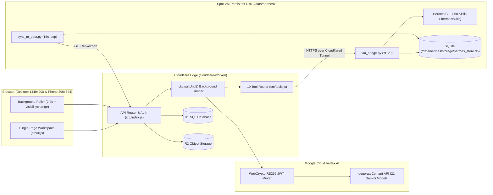
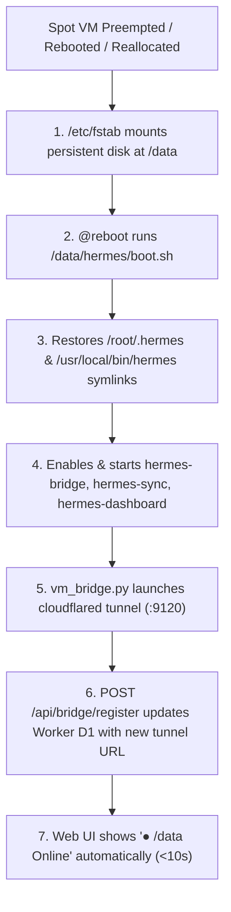

# System Architecture & Technical Reference (`docs/ARCHITECTURE.md`)

This document provides an in-depth technical reference for the **Hermes Agent Autonomous Web Workspace** across its three cooperating tiers:
1. **Cloudflare Edge Tier (`cloudflare-worker/`)**: Cloudflare Worker, D1 SQL Database, and R2 Object Storage.
2. **Google Cloud Vertex AI Tier**: 21 Gemini Models, Thinking Budget control (`thinkingConfig`), and Function Calling (`19` native Hermes tools).
3. **Spot VM / General VM Tier (`spot-vm-bridge/`)**: Persistent `/data/hermes` filesystem, `vm_bridge.py` HTTP execution server, `cloudflared` dynamic tunnel registration, `sync_to_data.py` SQLite mirror, and `boot.sh` preemption recovery.

---

## 1. End-to-End Component Architecture



---

## 2. Google Cloud Vertex AI Integration & Thinking Budgets

### 2.1 Zero-Dependency WebCrypto RS256 OAuth2 Token Minter
Cloudflare Workers run on the V8 isolate runtime without Node's native `google-auth-library`. In `cloudflare-worker/src/index.js`, `getAccessToken(env)` implements RFC 7523 JWT Bearer authentication directly using the Web Crypto API (`crypto.subtle`):
1. Parses `env.GCP_SA_KEY` (`client_email` and `private_key` PKCS#8 PEM).
2. Imports the RSA private key via `crypto.subtle.importKey("pkcs8", ..., { name: "RSASSA-PKCS1-v1_5", hash: "SHA-256" })`.
3. Signs a JWT with scope `https://www.googleapis.com/auth/cloud-platform` valid for 3,600 seconds.
4. Exchanges the assertion at `https://oauth2.googleapis.com/token` and caches the bearer token in worker memory until 5 minutes before expiration.

### 2.2 21 Gemini Models & Thinking Budget Mapping
Every model in `VERTEX_MODELS` (`src/index.js`) maps a user-facing ID (such as `gemini-3.8-flash-thinking`, `gemini-3.1-pro-thinking`, or `gemini-2.5-flash`) to its underlying Vertex AI model identifier and default thinking posture:

| Thinking Level ID | Token Budget (`thinkingBudget`) | Use Case |
| :--- | :--- | :--- |
| `auto` | Model Default (`8192` for `-thinking` variants) | Balanced reasoning and speed |
| `none` | `0` (Thinking disabled) | Lowest latency chat & simple tool calls |
| `low` | `1024` tokens | Quick multi-step tool planning |
| `medium` | `4096` tokens | Standard coding & debugging |
| `high` | `16384` tokens | Complex architectural design & multi-file refactoring |
| `max` | `24576` tokens | Maximum deep reasoning & math/algorithmic verification |

When `thinkingBudget > 0`, `callVertexGemini()` attaches:
```json
{
  "generationConfig": {
    "temperature": 0.4,
    "maxOutputTokens": 8192,
    "thinkingConfig": {
      "includeThoughts": true,
      "thinkingBudget": 16384
    }
  }
}
```
Any response parts returned with `part.thought === true` are aggregated into the assistant message's `thinking` field and displayed in the collapsible purple `🧠 Thinking Process` box in the UI.

---

## 3. Unstoppable Background Execution (`Keep-Alive: ON`)

When a user triggers a prompt from a phone browser and immediately locks the phone or closes the tab, standard HTTP streaming connections terminate. To guarantee completion:

1. **Immediate Job Creation**: `POST /api/chat` writes the user message to D1 `messages`, creates an assistant placeholder row with `status = 'running'` in D1 `messages`, and registers a job record.
2. **Detached Worker Execution (`ctx.waitUntil`)**: When `body.background !== false` (the default `Keep-Alive: ON` mode in the UI), the Worker wraps the entire `executeChatJob()` promise inside `ctx.waitUntil(jobPromise)` and immediately returns HTTP 200 with `{ status: "running", session_id, message_id, job_id }`.
3. **Multi-Turn Agentic Tool Loop in Background**: Inside `executeChatJob()`, the Worker runs up to 8 tool-calling turns with Vertex AI and the Spot VM bridge (`vm_bridge.py`). After each tool call, intermediate progress is saved to D1 so open browsers can watch tool calls appear in real time.
4. **Completion & Persistence**: Once the final answer is generated, the Worker updates the D1 `messages` row (`status = 'completed'`, `content`, `thinking`, `tool_calls`) and writes a full JSON snapshot to Cloudflare R2 (`sessions/<session_id>.json`).
5. **Client Reconnection & Auto-Polling**: In `src/ui.js`, `startBackgroundPoller()` polls `/api/sessions/<activeSessionId>` every `2.2s` while any message has `status === 'running'`, and also triggers immediately on `document.addEventListener('visibilitychange')` and `window.addEventListener('focus')` when a user unlocks their phone or reopens the tab.

---

## 4. Spot VM Preemption Survival & Triple-Redundant Storage



### Triple-Redundant Storage Layers
1. **Layer 1 — Cloudflare D1 (`hermes-memory-db`)**: Low-latency edge relational store for `sessions`, `messages`, `memories`, `skills`, `todos`, `cron_jobs`, and `settings`.
2. **Layer 2 — Cloudflare R2 (`hermes-persistent-storage`)**: Durable object storage mirroring every session (`sessions/<id>.json`), memory file (`memories/MEMORY.md`, `memories/SOUL.md`, `memories/USER.md`), and full state export (`state/full_export.json`).
3. **Layer 3 — Spot VM Persistent Disk (`/data/hermes/storage/hermes_store.db`)**: Local SQLite database and `/data/hermes/storage/sessions/*.json` updated every 15 seconds by `sync_to_data.py`, plus live `/data/hermes/.hermes/skills/` and `/data/hermes/.hermes/memories/` files.

---

## 5. The 19 Native Hermes Agent Tools (`cloudflare-worker/src/tools.js`)

| # | Tool Name | Execution Target | Description |
| :--- | :--- | :--- | :--- |
| 1 | `terminal` | Spot VM `/data/hermes` | Execute bash commands, git, CLI utilities, or `hermes` subcommands on `/data/hermes` |
| 2 | `execute_code` | Spot VM `/data/hermes` | Run isolated Python 3 or Node.js scripts on `/data/hermes/storage/scratch` |
| 3 | `read_file` | Spot VM `/data/hermes` | Read files from `/data/hermes` with line ranges |
| 4 | `write_file` | Spot VM `/data/hermes` | Create or overwrite files on `/data/hermes` |
| 5 | `patch` | Spot VM `/data/hermes` | Replace exact target substrings inside existing files on `/data/hermes` |
| 6 | `search_files` | Spot VM `/data/hermes` | Search file contents (`grep -rn`) or file names (`find`) on `/data/hermes` |
| 7 | `web_search` | Cloudflare Edge | Search the live web via DuckDuckGo/HTML extraction |
| 8 | `web_extract` | Cloudflare Edge | Fetch and extract clean markdown/text from any public URL |
| 9 | `mixture_of_agents` | Vertex AI Edge | Run parallel synthesis across 3 Gemini flagship models and merge via an aggregator model |
| 10 | `memory` | D1 + R2 + `/data` | Read, append, or update `MEMORY.md`, `SOUL.md`, and `USER.md` |
| 11 | `skills_list` | D1 + `/data` | List all 60+ procedural skills in `/data/hermes/.hermes/skills` |
| 12 | `skill_view` | D1 + `/data` | Read the full `SKILL.md` instructions for a specific skill |
| 13 | `skill_create` | D1 + R2 + `/data` | Create or update a procedural `SKILL.md` in `/data/hermes/.hermes/skills/<name>/SKILL.md` |
| 14 | `todo` | D1 + `/data` | Manage Kanban tasks (`todo`, `in_progress`, `done`) |
| 15 | `session_search` | D1 SQLite | Full-text search across past conversation sessions and messages |
| 16 | `cronjob` | D1 + `/data` | Create, list, toggle, or delete recurring scheduled agent jobs |
| 17 | `delegate_task` | Vertex AI Edge | Spawn an isolated subagent call with its own system prompt and task |
| 18 | `clarify` | Web UI | Present structured clarification questions to the user |
| 19 | `text_to_speech` | Web UI (SpeechSynthesis) | Mark responses for automatic browser Text-to-Speech readout |
